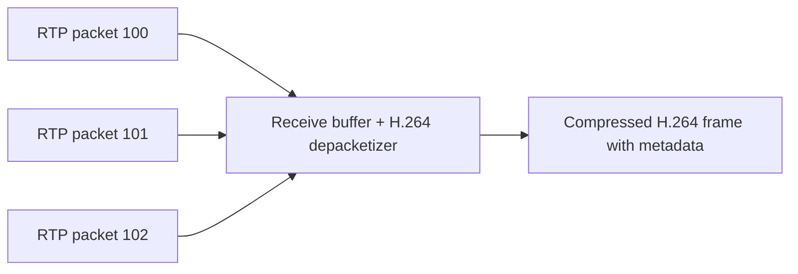

# RTP Packet to Frame Assembly



## Input: `RtpMeta`

Metadata for one incoming RTP packet. The compressed payload bytes are supplied separately.

| Field | Rust type | Description |
|---|---|---|
| `received` | `Instant` | Local arrival time of the packet. |
| `time` | `MediaTime` | Media time derived from the RTP timestamp. |
| `seq_no` | `SeqNo` | Extended sequence number accounting for RTP sequence-number wraparound. |
| `header` | `rtp::header::Header` | Existing WebRTC stack's RTP header, including the marker bit and extensions. |
| `last_sender_info` | `Option<Arc<rtcp::sender_report::SenderReport>>` | Latest RTCP Sender Report for the stream, shared between packets, if available. |

## Output: `Depacketized`

An assembled frame containing compressed media bytes and metadata.

| Field | Rust type | Description |
|---|---|---|
| `time` | `MediaTime` | Media time of the frame. |
| `contiguous` | `bool` | Whether the frame continues from the previous output without a discontinuity. |
| `meta` | `Vec<RtpMeta>` | Metadata of the contributing RTP packets. |
| `data` | `Vec<u8>` | Assembled compressed frame bytes. |
| `codec_extra` | `CodecExtra` | Codec-specific metadata, such as the H.264 keyframe flag. |

### MediaBridge time and sequence types

`SeqNo(pub u64)` holds an already extended sequence number. `MediaTime` holds
`ticks: u64` (an already extended RTP timestamp) and `clock_rate: NonZeroU32`
(the negotiated ticks per second). Counter extension is not implemented by these
containers. Values belong to one RTP stream; audio and video timestamps are not
automatically synchronized or directly comparable across streams.

These input/output types are available in `src/frame.rs`. Receive buffering and
server integration are not implemented yet. The RTP header and sender report
reuse `rtc-rtp` and `rtc-rtcp` version 0.21.1, matching the server dependencies.

## Receiving packets: `push()`

`DepacketizingBuffer::push()` accepts packet metadata and payload bytes:

```rust
pub fn push(
    &mut self,
    meta: RtpMeta,
    data: impl Into<Arc<[u8]>>,
)
```

It performs the following steps:

1. **Discard old packets:** If `hold_back > 0`, discard packets whose sequence
   number is at or before the last processed sequence number.
2. **Detect duplicates:** Ignore a packet if its sequence number is already in
   the buffer.
3. **Insert in sequence order:** Store the packet according to its extended
   sequence number, regardless of arrival order.
4. **Record boundaries:** Ask the codec depacketizer for the packet's `head` and
   `tail` flags and store them with the packet.

The buffer holds at most 4,096 packets. When full, a new packet older than all
retained packets is discarded; otherwise, the oldest retained packet is removed
to make room.

### H.264 boundary flags

| Flag | Detection |
|---|---|
| `head` | For FU-A/FU-B fragments, check the fragment header's start bit. For other packets with at least two bytes, return `true`. Packets shorter than two bytes return `false`. |
| `tail` | Use the RTP header's marker bit. |

`head` alone does not mean that a new video frame starts here. A frame can contain
multiple NAL units. Frame grouping is handled later when the buffer is read.

For example, packets belonging to one fragmented H.264 NAL unit may arrive out
of order:

```text
Arrival order:  packet 102 → packet 100 → packet 101

After push():  [100: head] [101] [102: tail]
```

`push()` stores and orders packets; it does not emit an assembled frame.
`pop()` subsequently attempts to assemble and return a frame from the buffer.

## Inspecting the RTP marker bit in Wireshark

For an H.264 RTP stream, the marker bit identifies the last packet of a video
frame. In Wireshark, expand a packet's **Real-Time Transport Protocol** section.
The following is an illustrative example, not an actual capture:

```text
▼ Real-Time Transport Protocol
    Version: 2
    ...
    1... .... = Marker: True
    Payload type: DynamicRTP-Type-96 (96)
    Sequence number: 102
    Timestamp: 90000
```

Example packet sequence within one RTP stream:

| Sequence number | RTP timestamp | Marker | Meaning |
|---|---|---|---|
| 100 | 90000 | False | Packet belonging to frame A. |
| 101 | 90000 | False | Another packet belonging to frame A. |
| 102 | 90000 | True | Last packet of frame A. |
| 103 | 93000 | False | Packet belonging to frame B. |

To display only packets with the marker bit set, use this Wireshark display filter:

```wireshark
rtp.marker == 1
```

The field name is `rtp.marker`. This interpretation as the end of a video frame
applies to H.264; the meaning of the marker bit depends on the RTP payload format.
The H.264 FU end bit is separate: it ends a fragmented NAL unit, which need not
be the last NAL unit of the frame.

Reference: [Wireshark RTP display filter reference](https://www.wireshark.org/docs/dfref/r/rtp.html).

## NAL units: Network Abstraction Layer

NAL stands for **Network Abstraction Layer**. A NAL unit is a building block of
an H.264 bitstream: a header followed by data, such as compressed picture data
or decoder parameters (SPS/PPS). It is not simply an arbitrary transport segment.

A video frame can contain multiple NAL units. RTP can carry a complete NAL unit,
aggregate multiple NAL units in one packet, or split a large NAL unit across
multiple packets.

```text
Video frame
 ├─ NAL unit A → RTP packet 100
 └─ NAL unit B → RTP packets 101, 102, 103
```

## Assembling payloads: `depacketize()`

The receive buffer passes each candidate's payloads to `H264Depacketizer` in
sequence-number order. The depacketizer handles these cases:

| Payload format | Processing |
|---|---|
| Single NAL unit | Append the complete NAL unit to the output. |
| STAP-A | Extract the aggregated NAL units and append each to the output. |
| FU-A | Accumulate fragments; reconstruct and append the NAL unit when its FU end bit is set. |

```text
Packet 100: FU start + data A → fragment buffer: A
Packet 101:            data B → fragment buffer: A+B
Packet 102: FU end   + data C → output: start code + reconstructed NAL header + A+B+C
```

The depacketizer also identifies IDR NAL units and records the keyframe flag in
`codec_extra`. The receive buffer builds `Depacketized` from the compressed
output bytes, media time and contributing packet metadata. This step neither
decodes video nor creates MoQ groups.

## Annex B start codes

Annex B is an H.264 byte-stream format. A start code marks the beginning of a
NAL unit, allowing a reader to find the boundaries between consecutive NAL units.
Start codes use `00 00 01` or `00 00 00 01`; the copied H.264 depacketizer's default
output uses the four-byte form:

```text
00 00 00 01 | NAL header | NAL data
00 00 00 01 | NAL header | NAL data
```

A start code does not identify a keyframe, a complete video frame or a MoQ group.
It separates NAL units in the byte stream. The depacketizer adds these codes when
producing Annex B output from RTP payloads. With `is_avc = true`, it instead writes
a four-byte NAL length prefix before each NAL unit.

```text
ARRIVAL OF RTP PACKETS
────────────────────────────────────────────────────────
Packet 100: [complete NAL A]          Timestamp 90000
Packet 101: [start of NAL B]          Timestamp 90000
Packet 102: [middle of NAL B]         Timestamp 90000
Packet 103: [end of NAL B]            Timestamp 90000
                                     Marker = true
                         │
                         ▼
RECEIVE BUFFER
────────────────────────────────────────────────────────
[100] [101] [102] [103]

Same timestamp, no sequence-number gaps,
frame end identified by the marker bit.
                         │
                         ▼
H.264 DEPACKETIZER
────────────────────────────────────────────────────────
Packet 100               → retain complete NAL A
Packets 101 + 102 + 103   → reconstruct NAL B
                         │
                         ▼
OUTPUT: ONE COMPRESSED FRAME
────────────────────────────────────────────────────────
[start code][NAL A][start code][NAL B]
```
