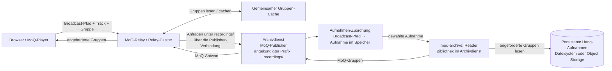
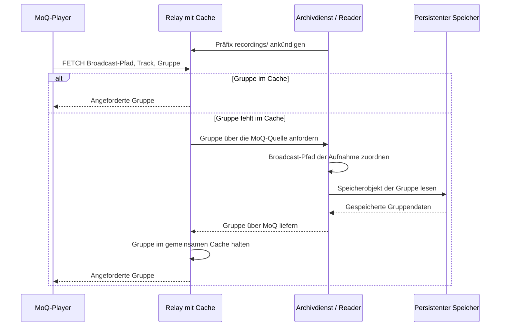

# MoQ-Archiv: Routing über einen gemeinsamen Pfadpräfix

Stand: 31. Oktober 2026. Festgehaltenes Architekturkonzept, keine Beschreibung einer bereits in Shig implementierten Funktion.

## Rollen und Zuordnungen

`recordings/` ist ein beispielhafter, noch nicht festgelegter Präfix. Ein Broadcast könnte darunter etwa `recordings/<aufnahme-id>` heißen.

Der Archivdienst kündigt den gemeinsamen Präfix an. Der Relay ordnet passende Broadcast-Anfragen dieser Publisher-Verbindung zu. Der Archivdienst löst den vollständigen Broadcast-Pfad auf eine konkrete Aufnahme auf und verwendet den Reader zum Lesen ihrer Tracks und Gruppen. Der Relay kennt weder Speicherpfade noch Storage-Zugangsdaten.

Eine Ankündigung des Präfixes ersetzt die einzelnen Routenankündigungen pro Aufnahme. Sie sagt aus, dass der Dienst Anfragen unter diesem Präfix bedienen kann; sie ist kein Verzeichnis aller vorhandenen Aufnahmen. Nicht vorhandene oder nicht freigegebene Aufnahmen muss der Dienst entsprechend behandeln. Aufnahme, Veröffentlichung und Erreichbarkeit sind getrennte Zustände.

## Abruf bei fehlender Cache-Gruppe

Der Cache ist gemeinsam; Nutzer dürfen unabhängig unterschiedliche Gruppen anfordern. Seine Aufbewahrung ist begrenzt. Die dauerhafte Verfügbarkeit kommt vom Archiv, nicht vom Relay-Cache.

## Dokumentierter Stand und offene Integration

- **Dokumentiert:** MoQ-Präfixankündigungen und Routing, individuelle FETCH-Anfragen sowie Nachladeaufträge bei Cache-Misses in `moq-net`.
- **Dokumentiert:** `moq-archive::Reader` stellt gespeicherte Aufnahmen als `moq_net`-Broadcast bereit. Der Hang-Entwurf beschreibt das Bedienen von FETCH aus Aufnahmen.
- **Noch im konkreten Reader-Code zu prüfen:** die vollständige Verbindung zwischen eingehendem Gruppen-Nachladeauftrag und Speicherzugriff. Das Sequenzdiagramm hält den vorgesehenen Ablauf fest; es behauptet keine bereits geprüfte Integration in Shig.
- **Nicht hier festgelegt:** Player-Unterstützung für Archivwiedergabe und Seek, Dienst-API, Prozessaufteilung und konkrete Pfadnamen.

## Quellen

- [MoQ-Lite: Broadcast und Präfixankündigungen](https://doc.moq.dev/draft/moq-lite#broadcast)
- [MoQ-Lite: Routing / Resolution](https://doc.moq.dev/draft/moq-lite#resolution)
- [MoQ-Lite: Fetch](https://doc.moq.dev/draft/moq-lite#fetch)
- [moq-net: Track-Implementierung (`Requests`, Cache-Miss und Nachladen)](https://github.com/moq-dev/moq/blob/main/rs/moq-net/src/model/track.rs)
- [moq-archive: Reader als Broadcast-Quelle](https://github.com/moq-dev/moq/blob/main/rs/moq-archive/src/lib.rs)
- [Hang: Reader Behavior](https://doc.moq.dev/draft/moq-hang#reader-behavior)
- [ObjectStore: lokales Dateisystem](https://docs.rs/object_store/latest/object_store/local/struct.LocalFileSystem.html)
