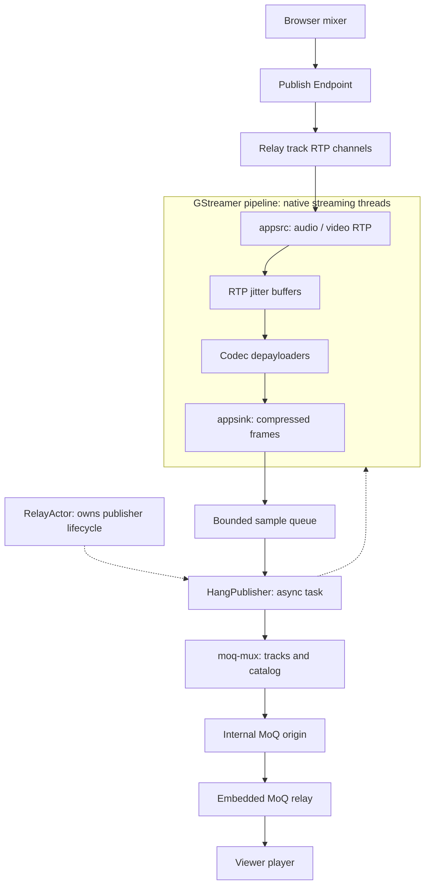

# Relay Architecture

The stream owner mixes guest and local video/audio in the browser and publishes the composed stream through WebRTC. GStreamer depayloads its RTP packets in the Shig process. `moq-mux` publishes the compressed frames directly into the embedded relay origin. There is no FFmpeg process, local UDP forwarding, fMP4 intermediate, or second QUIC publishing connection.

## Components



`RelayActor` remains the Actix owner. The publisher is an async task, not a second actor. It subscribes to both track channels before starting the pipeline. Startup completes only after the pipeline and MoQ track importers have been created. GStreamer initialization and teardown run on Tokio's blocking pool; GStreamer manages its own streaming threads. The task holds only a weak address to its owning actor.

## Media Path

Video codec, RTP payload type, clock rate, and fmtp parameters come from the received track. The adapter supports VP8, VP9, H264, H265, and AV1 when their GStreamer plugins are installed. H264/H265 parsers output Annex B access units; VP8/VP9 output whole compressed frames. Audio is Opus at a 48 kHz RTP clock, with the negotiated channel count. Unsupported codecs fail explicitly instead of being interpreted as H264. Nothing is decoded, mixed, or re-encoded on the server.

Both paths use a 50 ms RTP jitter buffer. The appsrc arrival timestamps share the pipeline running clock; GStreamer derives frame timestamps from the RTP clocks. This is not full RTCP Sender Report based A/V clock synchronization. Live playback and long-running audio/video synchronization must also be checked with the browser.

The publisher requests a video keyframe after startup. Delta frames are withheld until GStreamer marks a complete keyframe. A discontinuity after startup resets this gate and requests another keyframe. `moq-mux` creates video groups at keyframes; audio groups are explicitly closed after each Opus frame so late viewers do not subscribe to an unbounded audio group.

Browsers are not assumed to generate periodic video keyframes. While frames arrive, the publisher requests the next keyframe when the current group reaches two seconds, half of moq-net's 32 MiB byte limit, or half of its 8192-frame limit. Unanswered requests are retried at most once per second, and an actual keyframe resets the counters. Delta frames never start a new group. These requests reduce the risk of hitting the hard limit; an encoder that ignores PLI can still exceed it. Video write errors include the group's frame and payload-byte counts; audio errors are labeled separately.

## Buffer Ownership and Limits

The RTP adapter serializes the header separately and wraps the existing reference-counted payload as GStreamer memory. It does not marshal and copy the entire RTP packet into a new contiguous buffer. Each appsink callback queues an owned sample without blocking. The publisher wraps the readable mapped frame in `Bytes::from_owner`, retaining GStreamer's allocation until MoQ releases it.

This avoids additional payload copies at our Rust/GStreamer boundaries, but is not a claim that depayloading, buffer mapping, parsers, or transport encryption never copy internally.

Each appsrc input queue is limited by a 4 MiB high-water check. The shared output queue holds at most 128 samples. Overflow, RTP broadcast lag, pipeline errors, and closed channels terminate the publication with an error. They do not silently discard arbitrary compressed frames or block the SFU receive loop. These are queue limits, not a strict total pipeline memory budget.

## Shutdown

Stopping a publication cancels the publisher loop, finishes the MoQ tracks, and sets the pipeline to `Null` on the blocking pool. The actor's stop handler waits for task completion. During SFU shutdown the lobby waits for this teardown before replying, so the runtime does not exit first. Dropping the actor also cancels its task. Completion messages identify the running instance so an old shutdown cannot clear a newly started publication. Other broadcasts and the embedded relay remain running.

The embedded `moq_relay::Relay` owns its transport listeners, Web API, and shutdown. `RelayState` provides shared handles for internal publishing and the additional Actix endpoints.

## Dependencies

Rust uses `gstreamer` and `gstreamer-app` 0.24 with GStreamer >= 1.24. Required runtime elements are `appsrc`, `appsink`, `rtpjitterbuffer`, `rtpopusdepay`, and the selected video depayloader. H264/H265 also require `h264parse`/`h265parse`; AV1 requires `rtpav1depay` and `av1parse`, which must be provided by the installed plugin set. VP8/VP9/Opus do not require an encoder or decoder in production.

On macOS:

```sh
brew install gstreamer
```

On a Debian/Ubuntu release providing GStreamer >= 1.24:

```sh
sudo apt install pkg-config libgstreamer1.0-dev libgstreamer-plugins-base1.0-dev gstreamer1.0-plugins-base gstreamer1.0-plugins-good gstreamer1.0-plugins-bad
```

The real-RTP tests additionally use VP8/VP9 and H264 encoders. H264 test generation requires the `x264enc` plugin (`gstreamer1.0-plugins-ugly` on Debian/Ubuntu).

The MoQ libraries are `moq-relay 0.17.5`, `moq-net 0.3.13`, `moq-mux 0.10.14`, `moq-tokio 0.19.26`, and `moq-auth 0.2.1`. Playback uses the existing player's configured latency; the SDK announcement polling remains separate from the player's relay connection.
