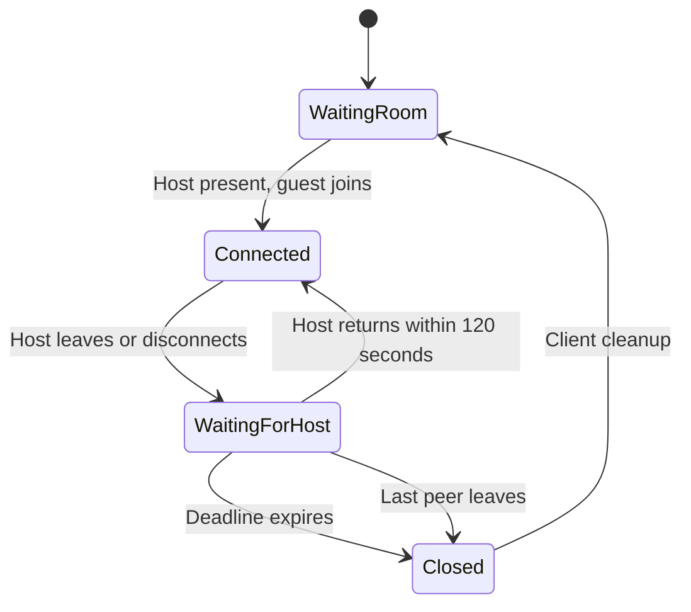

# Host Presence and Lobby Lifetime

Host presence is independent of whether a livestream is running. The host is present when both of its WebRTC endpoints are connected. Only the host can create a lobby. Guests can join only while the host is present; the lobby actor checks this before setup and again before returning a successful setup result.

Guests outside the lobby poll the authenticated `GET /api/channel/{channel}/stream/{stream}/lobby/host` endpoint every five seconds. It retains the existing invitation and channel/stream checks and reads presence from the SFU, not from the database's `is_open` field. Polling stops during joining and while connected, resumes after leaving or a failed join, and is disposed when the component is destroyed. Poll errors keep joining disabled until a later successful poll.

Connected peers receive control message type `4`, with `data` equal to `present`, `waiting`, or `closed`. Opening the control channel requests the current snapshot, so a peer does not rely on having observed an earlier transition. Guest messages cannot set host presence.

When the host leaves or either host endpoint disconnects, the relay stops immediately. Existing guests stay connected and see "Waiting for host"; new guests cannot join. The lobby starts one cancellable timer. Its default duration is 120 seconds, configured with `host_grace_seconds` under `[sfu]`. Repeated disconnect events do not extend the deadline. Host recovery cancels the timer but does not automatically restart the livestream.

If the deadline expires, the lobby rejects further setup, sends `closed`, shuts down all peers and the relay, and uses the existing participant removal and lobby-offline database paths. Sending the final control notification is bounded and must not prevent peer teardown. An unexpected control-channel closure also triggers client cleanup. Clients return to setup and display a closure message while keeping their local camera/microphone preview and device settings ready for rejoining. Capture devices are released when the setup page is actually left, not when the guest is removed from the lobby.

If the last peer leaves before the deadline, the empty lobby closes immediately. Existing per-endpoint 20-second disconnect timers still govern whether an individual broken peer is removed; they do not replace or restart the lobby's host grace timer.

