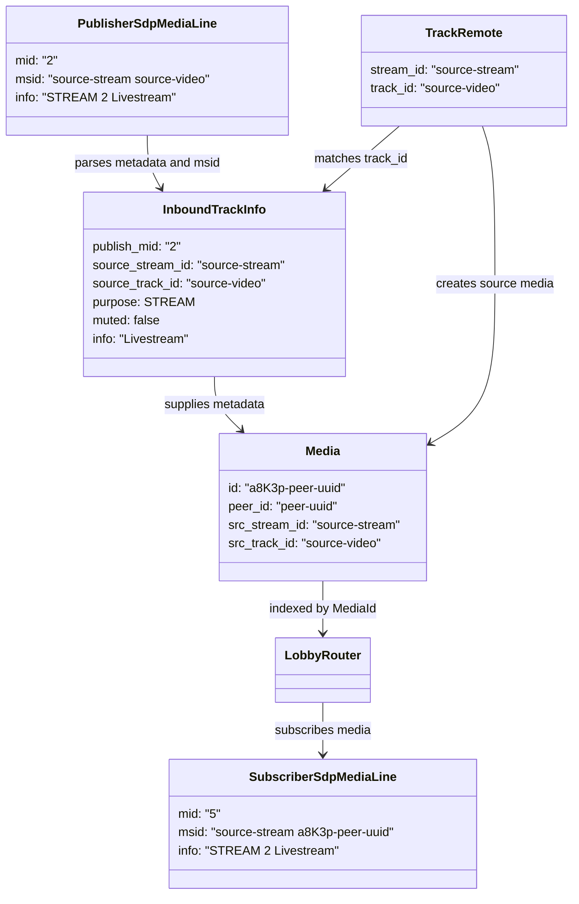

# SFU Media Forwarding

## Routing Identity

The media router uses the SFU track ID (`MediaId`) as its routing identity. A publisher track creates one `Media` entry. Subscribers add a subscription to that entry and receive its RTP packets.

```text
MediaId -> Media -> subscriber targets
```

SSRC is not a router key. It remains an RTP header property required by the WebRTC sender for its negotiated encoding.

## Track And Metadata Identity

The router owns one `Media` object per incoming publisher track. Its `MediaId` is the SFU routing key and the forwarded subscriber track ID. The original publisher stream ID is preserved so related audio and video tracks still belong to the same browser stream on the subscriber side.

Publisher and subscriber MIDs are connection-local identifiers. They must not be used as a lobby-wide identity. `MediaId` connects the two MID spaces for SFU operations such as remove and mute.



### Planned Metadata Correction

The current publish endpoint matches an incoming `TrackRemote` to `InboundTrackInfo` only by media kind (`audio` or `video`). That is insufficient when one publisher offers multiple video tracks or multiple audio tracks: arrival order is not an identity.

Before supporting those cases, the SDP parser must retain the `a=msid` stream and track IDs in `InboundTrackInfo`. When `TrackRemote` opens, the publish endpoint must match `TrackRemote.track_id()` to the parsed source track ID, with the source stream ID available as an additional validation. This makes `purpose`, `muted`, `info`, and the publisher MID attach to the correct track regardless of arrival order.

The client-side mapping remains unchanged:

```text
subscriber MID -> SDP metadata -> forwarded MediaId -> publishing peer ID
```

The SDK should treat MIDs as strings. SDP permits arbitrary MID tokens even though the current SFU happens to produce numeric MIDs.

## Current Forwarding Path

The current implementation distributes each inbound packet through a Tokio broadcast channel. Every subscriber has a receiver task which passes the packet to its local WebRTC sender.

```text
publisher RTP
-> Media broadcast channel
-> subscriber receiver task
-> TrackLocalStaticRTP.write_rtp
-> subscriber PeerConnection driver
-> SRTP and UDP
```

The RTP payload is stored in `bytes::Bytes`, so cloning an `rtp::Packet` shares the payload buffer. Its header and extension vector are still cloned for every subscriber.

## Target Direction

The intended SFU hot path replaces the generic broadcast channel with prepared direct targets. Reconciliation updates the target list when media or subscriptions change; packet forwarding only reads that prepared list.

```text
MediaId -> prepared forward targets

publisher RTP
-> direct fan-out to target queues or a shared core worker
-> subscriber PeerConnection sender
-> SRTP and UDP
```

This removes the broadcast receiver task and its extra wakeup from the forwarding path. It does not change the routing identity: tracks continue to be routed by `MediaId`.

## Unavoidable Per-Target Work

Every subscriber has an independent WebRTC transport, including keys and UDP destination. For each target, the SFU must therefore perform SRTP protection and emit an individual UDP datagram.

The goal is not to remove this required work. The goal is to avoid unnecessary payload copies, allocations, scheduler wakeups, and general-purpose channel hops before it.

## Zero-Copy Rule

The SFU must preserve shared RTP payload storage during fan-out. A future forwarding interface should pass packet references or shared packet storage to prepared targets. It must not copy encoded media payload bytes merely to route a packet.

The current public WebRTC.rs async track API consumes an owned `rtp::Packet` through `TrackLocalStaticRTP::write_rtp`. Any deeper removal of packet-header clones therefore requires either a reference-based API at that boundary or a lower-level RTC-core integration. This is a future optimization, not a reason to change routing semantics today.
