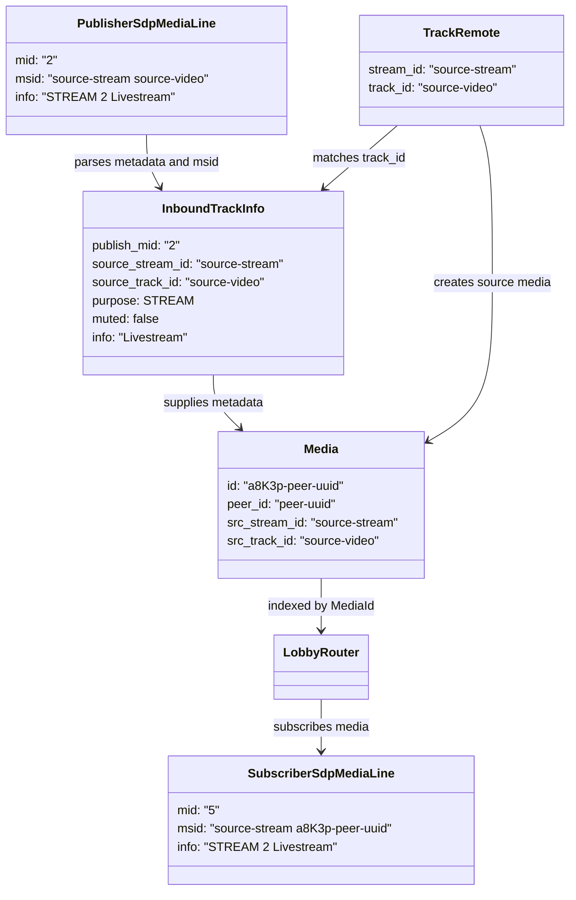

# SFU Media Forwarding

## Receive Delivery Diagnostics

`RTP receive delivery` logs once per second at DEBUG per source track and SSRC, immediately after `TrackRemote::poll()` delivers RTP and before relay or subscriber forwarding. This measures application delivery after both the jitterbuffer and the internal TrackRemote event queue; it cannot isolate jitterbuffer residence time.

- `packets`: delivered packets in this window, including late or duplicate packets.
- `delivery_gap_max_ms`: largest interval between consecutive deliveries, including across reporting boundaries. It is recorded when the next packet arrives; a completely silent window reports zero packets.
- `delivery_pairs_le_1ms`: consecutive deliveries at most 1 ms apart. Video packetization naturally produces bursts, so this alone does not imply a stall.
- `sequence_gaps`: newly observed missing sequence numbers, provisionally, not confirmed packet loss.
- `late_gap_fills`: previously missing sequence numbers delivered later, including gaps from earlier windows.
- `missing_pending`: still-open sequence gaps, retained across windows.
- `old_or_duplicate`: packets behind the highest sequence number that do not fill a tracked gap; these cannot always be classified as duplicates.
- `missing_aged_out`: unresolved gaps removed from the bounded 4096-sequence tracking window or cleared after a discontinuity; this is not proof of network loss.
- `sequence_discontinuities`: forward jumps larger than the tracking window, treated as ambiguous restarts/jumps instead of thousands of missing packets.

Sequence comparisons handle 16-bit wraparound. Counters reset per report, while sequence tracking and the previous delivery timestamp persist. Measurement does not change jitterbuffer parameters or packet forwarding.

## Subscriber Queue Diagnostics

Each active subscriber-track sender logs `RTP forward queue` once per second at DEBUG level, identified by `media_id` and `subscriber_peer_id`.

- `queue_pending`: retained packets still waiting, excluding the in-flight write (capacity 512).
- `queue_max_observed`: highest sampled pending count in this reporting window; not an exact high-water mark.
- `queue_dropped`: overwritten packets reported by the broadcast receiver in this window. These are counted when the receiver next reads, so a blocked write can delay their report.
- `writes_completed`, `write_errors`: completed write attempts and errors in this window.
- `write_avg_ms`, `write_max_ms`: duration of completed `write_rtp().await` calls, including failed calls. A call spanning windows is counted when it finishes.
- `write_pending_ms`: elapsed time of the currently waiting call, or zero if none. Reporting continues while that call waits.

Window counters reset after each report. These durations measure application-side WebRTC enqueueing, not UDP transmission or receipt by the browser. A zero overflow count does not exclude stalls elsewhere. Logging stops when the sender is cancelled; no separate monitoring task is created.

## Routing Identity

The media router uses the SFU track ID (`MediaId`) as its routing identity. A publisher track creates one `Media` entry. Subscribers add a subscription to that entry and receive its RTP packets.

```text
MediaId -> Media -> subscriber targets
```

SSRC is not a router key. It remains an RTP header property required by the WebRTC sender for its negotiated encoding.

## Track And Metadata Identity

The router owns one `Media` object per incoming publisher track. Its `MediaId` is the SFU routing key and the forwarded subscriber track ID. The original publisher stream ID is preserved so related audio and video tracks still belong to the same browser stream on the subscriber side.

Publisher and subscriber MIDs are connection-local identifiers. They must not be used as a lobby-wide identity. `MediaId` connects the two MID spaces for SFU operations such as remove and mute.



### Track Metadata Matching

`InboundTrackInfo` retains the SDP `a=msid` stream and track IDs. When `TrackRemote` opens, the publish endpoint matches `TrackRemote.track_id()` to the parsed source track ID, with the source stream ID as an additional validation. This makes `purpose`, `muted`, `info`, and the publisher MID attach to the correct track regardless of arrival order.

For an offer without `a=msid`, the publish endpoint uses a media-kind fallback only if exactly one offered track of that kind remains. It refuses to guess when multiple same-kind tracks exist.

The client-side mapping remains unchanged:

```text
subscriber MID -> SDP metadata -> forwarded MediaId -> publishing peer ID
```

The SDK should treat MIDs as strings. SDP permits arbitrary MID tokens even though the current SFU happens to produce numeric MIDs.

## Forwarding Path

The router owns the active targets for every publisher `Media`. A target is created while the subscriber endpoint builds its SDP offer, but it becomes active only after the subscriber answer has been accepted. Local sender binding then completes asynchronously on the peer-connection driver.

```text
MediaId -> Media -> prepared active targets

publisher RTP
-> load prepared target list
-> non-awaiting enqueue into each subscriber track's 512-packet queue
-> dedicated sender task calls TrackLocalStaticRTP::write_rtp
-> subscriber PeerConnection sender
-> SRTP and UDP
```

Reconciliation replaces the prepared target list when a subscription is activated or removed. The publisher RTP reader loads that list and enqueues without awaiting any subscriber. Each target uses an existing Tokio broadcast ring with a single receiver, holding at most 512 packets. On overflow, oldest queued packets are evicted; the sender handles `Lagged` and resumes with the oldest retained packet. Payload bytes remain shared. One sender task per target preserves retained-packet order and waits on that subscriber's WebRTC driver independently. Removing a route or shutting down its endpoint cancels the sender. The task captures source feedback state without owning the route list, avoiding ownership cycles. No per-packet tasks are created. Tracks continue to be routed by `MediaId`.

The 512-packet limit applies to this application queue only. A sender may also hold one packet in an in-flight `write_rtp`, and WebRTC's existing driver queue remains separate. Overflow can discard parts of encoded frames; receiver PLI feedback requests recovery through the existing shared gate.

### Route Activation And Keyframes

After the subscriber answer, the peer reports the prepared target to the lobby router. The router adds it to the source `Media`. The first successful `write_rtp` confirms that WebRTC.rs has bound that local track to its sender. For video, that write sends one PLI to the source publisher track. This avoids racing the asynchronous binding with a keyframe request.

```text
subscriber answer accepted
-> target becomes active in MediaId route
-> first successful RTP write confirms the target binding
-> router sends one PLI to source publisher track
-> publisher emits keyframe
-> active targets receive RTP
```

The browser's ordinary PLI behavior remains the compatibility fallback. A future Dependency Descriptor optimization may identify a decodable start frame, but forwarding must not depend on that extension because browser support is not universal.

Subscriber PLI feedback follows the same `MediaId` route. A subscribe-only interceptor marks incoming PLI for application delivery after the standard RTCP interceptors have processed it. After the first successful RTP write confirms sender binding, a feedback reader consumes the local track's RTCP events and requests a keyframe on its source publisher track using the source SSRC.

All keyframe request sources of one `Media` share a 200 ms PLI gate: the first request is forwarded immediately; further requests within that window are suppressed. A new request at or after 200 ms can pass. Different source tracks have independent gates. Removing the subscription, closing the endpoint or dropping it cancels its feedback reader. Ordinary RTCP reports and NACK remain on their own WebRTC leg; FIR forwarding is not included in this PLI path.

While the live relay is running, its `STREAM` video track requests a keyframe every two seconds, starting two seconds after timer creation. Participant video tracks have no periodic rhythm. The timer stops with the relay publisher and skips missed ticks instead of sending a burst. The old group-age trigger at approximately 1–1.5 seconds is removed. Startup, recovery and projected group-cache-limit requests remain and use the same 200 ms gate as client PLI. A nearby client request can therefore satisfy/suppress a scheduled request; the timer does not guarantee exact keyframe arrival intervals.

## Unavoidable Per-Target Work

Every subscriber has an independent WebRTC transport, including keys and UDP destination. For each target, the SFU must therefore perform SRTP protection and emit an individual UDP datagram.

The goal is not to remove this required work. The goal is to avoid unnecessary payload copies, allocations, scheduler wakeups, and general-purpose channel hops before it.

## Zero-Copy Rule

The SFU must preserve shared RTP payload storage during fan-out. The target-specific RTP header and extensions are cloned and translated, but encoded media payload bytes must not be copied merely to route a packet.

The current public WebRTC.rs async track API consumes an owned `rtp::Packet` through `TrackLocalStaticRTP::write_rtp`. Any deeper removal of packet-header clones therefore requires either a reference-based API at that boundary or a lower-level RTC-core integration. This is a future optimization, not a reason to change routing semantics today.
