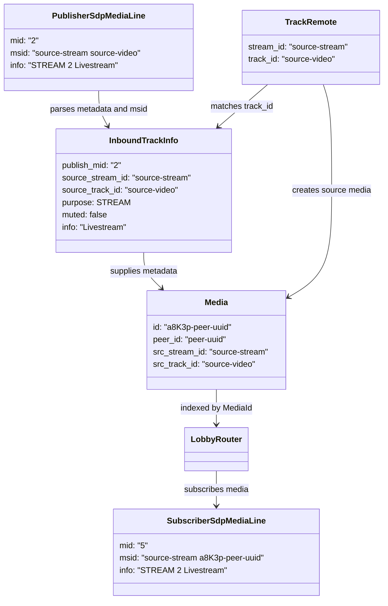

# SFU Media Forwarding

## Routing Identity

The media router uses the SFU track ID (`MediaId`) as its routing identity. A publisher track creates one `Media` entry. Subscribers add a subscription to that entry and receive its RTP packets.

```text
MediaId -> Media -> subscriber targets
```

SSRC is not a router key. It remains an RTP header property required by the WebRTC sender for its negotiated encoding.

## Track And Metadata Identity

The router owns one `Media` object per incoming publisher track. Its `MediaId` is the SFU routing key and the forwarded subscriber track ID. The original publisher stream ID is preserved so related audio and video tracks still belong to the same browser stream on the subscriber side.

Publisher and subscriber MIDs are connection-local identifiers. They must not be used as a lobby-wide identity. `MediaId` connects the two MID spaces for SFU operations such as remove and mute.



### Track Metadata Matching

`InboundTrackInfo` retains the SDP `a=msid` stream and track IDs. When `TrackRemote` opens, the publish endpoint matches `TrackRemote.track_id()` to the parsed source track ID, with the source stream ID as an additional validation. This makes `purpose`, `muted`, `info`, and the publisher MID attach to the correct track regardless of arrival order.

For an offer without `a=msid`, the publish endpoint uses a media-kind fallback only if exactly one offered track of that kind remains. It refuses to guess when multiple same-kind tracks exist.

The client-side mapping remains unchanged:

```text
subscriber MID -> SDP metadata -> forwarded MediaId -> publishing peer ID
```

The SDK should treat MIDs as strings. SDP permits arbitrary MID tokens even though the current SFU happens to produce numeric MIDs.

## Forwarding Path

The router owns the active targets for every publisher `Media`. A target is created while the subscriber endpoint builds its SDP offer, but it becomes active only after the subscriber answer has been accepted. Local sender binding then completes asynchronously on the peer-connection driver.

```text
MediaId -> Media -> prepared active targets

publisher RTP
-> load prepared target list
-> direct fan-out to TrackLocalStaticRTP
-> subscriber PeerConnection sender
-> SRTP and UDP
```

Reconciliation replaces the prepared target list when a subscription is activated or removed. The publisher RTP reader only loads that list and forwards to its entries. It does not use a broadcast channel, a subscriber receiver task, or a data channel. Tracks continue to be routed by `MediaId`.

### Route Activation And Keyframes

After the subscriber answer, the peer reports the prepared target to the lobby router. The router adds it to the source `Media`. The first successful `write_rtp` confirms that WebRTC.rs has bound that local track to its sender. For video, that write sends one PLI to the source publisher track. This avoids racing the asynchronous binding with a keyframe request.

```text
subscriber answer accepted
-> target becomes active in MediaId route
-> first successful RTP write confirms the target binding
-> router sends one PLI to source publisher track
-> publisher emits keyframe
-> active targets receive RTP
```

The browser's ordinary PLI behavior remains the compatibility fallback. A future Dependency Descriptor optimization may identify a decodable start frame, but forwarding must not depend on that extension because browser support is not universal.

Subscriber PLI and FIR feedback belongs to the same `MediaId` route: once feedback delivery from the subscriber WebRTC leg is enabled, the router relays those keyframe requests to the source publisher track. Ordinary RTCP reports stay on their own WebRTC leg and are not cross-routed.

## Unavoidable Per-Target Work

Every subscriber has an independent WebRTC transport, including keys and UDP destination. For each target, the SFU must therefore perform SRTP protection and emit an individual UDP datagram.

The goal is not to remove this required work. The goal is to avoid unnecessary payload copies, allocations, scheduler wakeups, and general-purpose channel hops before it.

## Zero-Copy Rule

The SFU must preserve shared RTP payload storage during fan-out. The target-specific RTP header and extensions are cloned and translated, but encoded media payload bytes must not be copied merely to route a packet.

The current public WebRTC.rs async track API consumes an owned `rtp::Packet` through `TrackLocalStaticRTP::write_rtp`. Any deeper removal of packet-header clones therefore requires either a reference-based API at that boundary or a lower-level RTC-core integration. This is a future optimization, not a reason to change routing semantics today.
