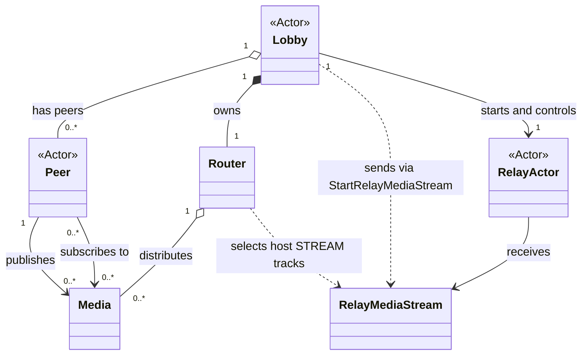
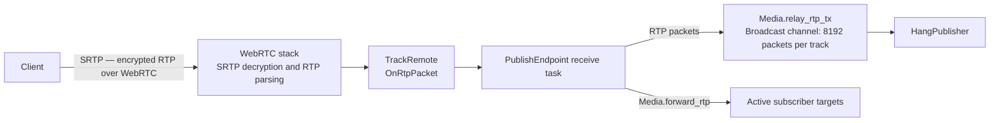
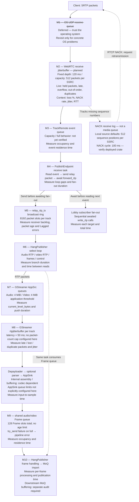
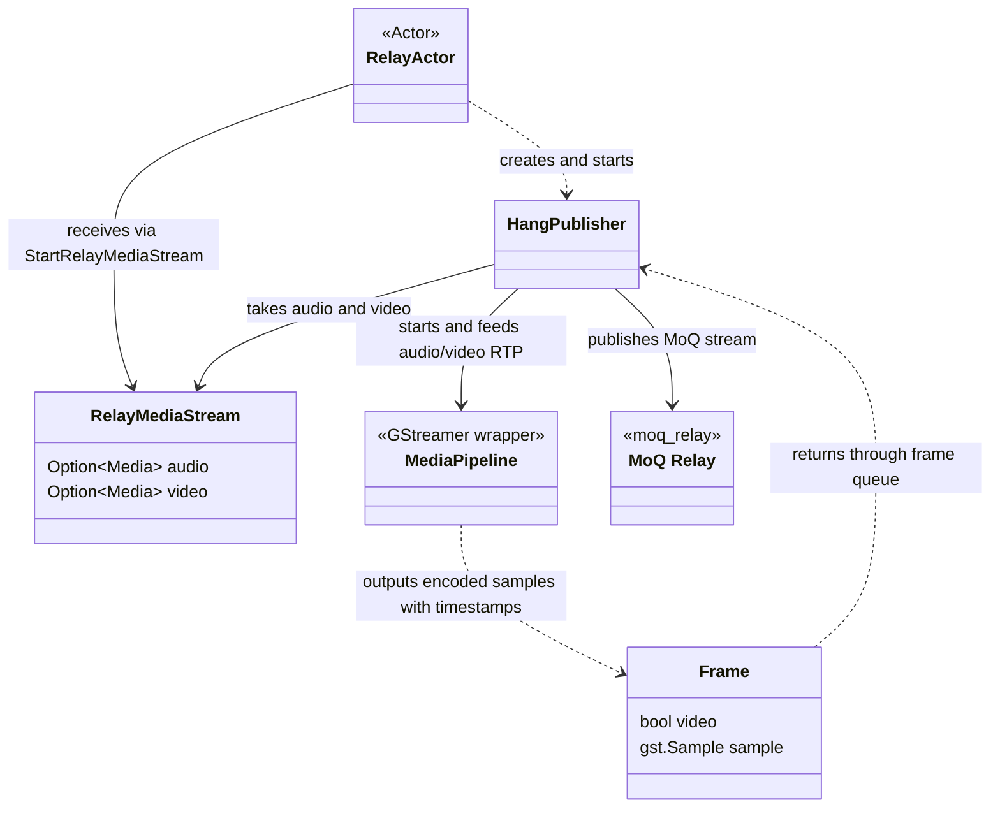

# WebRTC Bridge

## Lobby and peers

A Shig lobby has multiple regular peers. Both `Lobby` and `Peer` are actors.

A lobby can contain multiple peers. Each peer belongs to one lobby.
Peers publish media and subscribe to media from other peers. The lobby's router distributes media to subscribing peers.

`Lobby` selects the host's `STREAM` media through `Router::get_media_stream`. It passes the resulting `RelayMediaStream` to `RelayActor` in a `StartRelayMediaStream` message. The actor starts `HangPublisher`, which publishes the stream over MoQ.

Names in the diagrams match the types in the code. `Router` is not an actor.

## Client to lobby

The client sends media to the publishing peer's `PublishEndpoint` within the lobby. The endpoint belongs to `Peer`, rather than directly to `Lobby`. RTP media is encrypted as SRTP on the WebRTC transport.

The receive task forwards RTP packets without waiting for complete frames. The relay path uses a bounded broadcast channel per track. This channel is a packet queue, not the GStreamer jitterbuffer; jitter buffering for the relay happens later in `MediaPipeline`.

### Queues, buffers and measurement points

**Agreed goal:** Align the pipeline's waiting and discard deadlines so that downstream stages do not discard media while upstream packet recovery or frame assembly is still in progress. Retransmitted packets must have a chance to arrive within the downstream acceptance window.

The measurements should establish whether these windows fit together: incoming packet loss percentage, NACK activity, jitter, RTT, and the actual waiting/discard deadlines at the relevant buffering stages. This is the purpose of the investigation; it is not a general performance audit. The detailed measurement proposals below remain provisional.

This is a measurement map, not proof of congestion. Queue buildup, network loss, late retransmissions and scheduling pauses must be distinguished. Capacities are not current occupancies or fixed delays. Unknown values must be measured or verified in the deployed dependency version.

#### How to measure

| Point | Measurements and interpretation |
| --- | --- |
| ~~M1 — OS UDP receive queue~~ | Deferred. We trust the operating system and do not measure this point now. Keep it as a reserve investigation only if concrete operating-system problems arise. |
| M2 | Planned receive jitterbuffer: fixed depth/capacity plus per-SSRC occupancy and buffer counters, alongside packet loss %, NACK rate, jitter and RTT. Activation and a public stats accessor remain to be implemented. See the definition below. |
| M3 | Verify WebRTC.rs 0.21.1 track-event channel bounds and overflow behavior. Queue occupancy and residence time remain a separate, not yet agreed measurement proposal. |
| M4 | Time `Media::forward_rtp`, each awaited subscriber write and intervals between `track.poll()` results. Slow fan-out can delay the next receive even though relay publication is a separate branch. |
| M5 | Record receiver backlog and packet age per audio/video track. A slow broadcast receiver loses old entries and receives `Lagged`; the current publisher propagates this as an input error. Sending does not wait for that receiver. |
| M6 | Time each select branch. A long frame-processing or other branch delays RTP consumption in the same publisher task. |
| M7 | Sample `current_level_bytes` separately for audio/video. `push` rejects a packet when the existing queue level is already at least 4 MiB; one push may cross the threshold. `block=false`, so this is not a blocking backpressure limit. |
| M8 | Record GStreamer jitterbuffer stats and compare missing sequence numbers with NACK/retransmission timing. The local NACK default cycle is 100 ms while jitterbuffer latency is 50 ms; this deserves checking, but the clocks and processing stages differ, so it is not proof of a failure. |
| M9–M10 | Record queue depth, enqueue/dequeue timestamps, full errors and frame-import duration. Presentation timestamps are media timing; use separate monotonic timestamps for queue residence. |

Start with M4, M5, M7 and M9 to locate growth across the application boundary; collect M8 loss/late stats alongside them. M1 is deferred and excluded from current measurements. Use rates, high-water marks and p50/p95/p99 residence times rather than per-packet logs. Increasing capacity alone can hide a throughput problem and increase latency.

#### M2 definition — receive jitterbuffer and connection health

Scope: server-side reception of the publishing client's media. Keep audio and video separate, identified by peer/endpoint, MID, track identifier and SSRC. Use periodic stats snapshots; do not instrument individual packets.

Agreed design: enable the WebRTC receive jitterbuffer. Record its configured values together with its live diagnostics.

| Fixed configuration | Initial value |
| --- | --- |
| Waiting window (`depth`) | 120 ms |
| Packet capacity (`capacity`) | 512 packets per SSRC |

These initial values match the inspected upstream `master` defaults. They are planned settings, not currently active deployment values. `depth` is the configured RTP playout window, not a measured minimum/maximum packet residence time.

| Buffer measurement | Meaning |
| --- | --- |
| `len()` | Packets currently held per SSRC |
| `stats().late` | Packets rejected after their sequence position was already passed |
| `stats().overflow` | Drops caused by reaching packet capacity |
| `stats().out_of_order` | Arrivals behind an already observed higher sequence number |
| `stats().duplicates` | Duplicate packets rejected while already held |

Read counters periodically and use their changes per interval. Keep these buffer drops separate from sequence-based WebRTC packet loss. No per-packet timing is planned. The buffer exposes `stats()` and `len()`, but the inspected interceptor keeps its per-SSRC buffers private: exposing a read-only stats snapshot is required. These are not automatically available through `PeerConnection::get_stats()`.

Sources: upstream [buffer counters and occupancy](https://raw.githubusercontent.com/webrtc-rs/rtc/master/rtc-interceptor/src/jitterbuffer/buffer.rs) and [interceptor configuration](https://raw.githubusercontent.com/webrtc-rs/rtc/master/rtc-interceptor/src/jitterbuffer/receiver.rs). Match the release implementation before activation.

Connection-health context retained for M2:

| Required value | Existing source | Meaning and limitation |
| --- | --- | --- |
| Packet loss percentage | `inbound-rtp`: `packets_lost`, `packets_received` | Calculate interval loss as `100 * delta(lost) / (delta(received) + delta(lost))` for valid, aligned samples with positive expected count and nonnegative loss delta. Recovery, duplicates or counter resets can invalidate this simple interval calculation; report those intervals as unavailable, not as negative loss. Loss is sequence-based, not proof of a final late discard. |
| NACK activity | `inbound-rtp`: `nack_count` | `delta(nack_count) / elapsed_seconds`: sent NACK messages per second. One message can request multiple packets or repeat a request. NACK means retransmission requested, not deadline expired. |
| Arrival jitter | `inbound-rtp`: `jitter`, with codec clock rate | Arrival-time variation, not queue residence. Local implementation copies RTCP report jitter directly into the stats field, although the field documents seconds. Verify the deployed crate's units; raw RTCP timestamp units require division by codec clock rate to obtain seconds. |
| Connection RTT | Selected ICE candidate pair: `current_round_trip_time` | Latest STUN round-trip measurement in seconds, shared by tracks on that transport. Record sample availability/freshness. Not one-way delay or complete NACK recovery duration. |
| Jitterbuffer residence and deadline | No automatically populated receive measurement found | `jitter_buffer_delay`, `jitter_buffer_target_delay` and `jitter_buffer_emitted_count` are populated only from application-provided audio receiver stats in the inspected code, otherwise zero. Shig does not supply those updates. `jitter_buffer_minimum_delay` and `total_processing_delay` are hardcoded zero in the snapshot. Do not expose these zeros as measurements. |

**Result:** Existing stats provide connection-health and retransmission context for M2, but do not provide the desired minimum/maximum packet residence or late-discard deadline. Do not derive those times from RTT or jitter. Even when real cumulative jitterbuffer delay/count values are supplied, their ratio gives an average, not a maximum or discard deadline. The actual upstream waiting/discard behavior remains to be established before defining an additional measurement.

**Receive-path check:** No active time-based RTP jitterbuffer was found in the inspected local RTC receive path or Shig's default interceptor setup. `RTCRtpReceiverInternal::jitter_buffer_target` is declared and initialized to `Duration::default()` but has no other uses in that source. It is not an operational 0 ms jitterbuffer. The NACK generator records sequence numbers and forwards received packets; the endpoint handler dispatches RTP packets to the track without a jitterbuffer deadline. Therefore no WebRTC jitterbuffer size can currently be assigned to M2 from this implementation. The confirmed time-based jitterbuffer on the relay path is GStreamer's 50 ms buffer. Verify that the deployed registry crate matches this local source before treating this as a deployment finding.

**Version correction:** The local checkout differs from the published 0.21 release line. Official WebRTC.rs 0.21 release documentation explicitly provides an opt-in jitterbuffer interceptor. The published default registry lists NACK responder/generator, TWCC receiver and RTCP reports, without `JitterBuffer`. Shig calls `register_default_interceptors` and adds no jitterbuffer itself. Thus the evidence supports "not enabled by Shig's current configuration", not "WebRTC.rs has no jitterbuffer". Earlier local-source stats findings remain provisional until matched to the registry source. Sources: [official 0.21 announcement](https://webrtc.rs/blog/2026/09/19/announcing-webrtc-v0.21.0.html), [published default registry source and tests](https://docs.rs/rtc/latest/src/rtc/peer_connection/configuration/interceptor_registry.rs.html).

Source checks: `webrtcrs/rtc/src/statistics/accumulator/rtp_stream/inbound.rs` (population and snapshot), `statistics/accumulator/media/app_provided.rs` (application-provided audio stats), `peer_connection/handler/interceptor.rs` (loss/jitter from generated Receiver Reports), and `statistics/stats/ice_candidate_pair.rs` (RTT). These findings are from the local RTC source; deployment uses registry version 0.21.1 and must be matched before implementation. No runtime measurement has been added.

#### Evidence and open boundaries

- Application receive loop and relay ring: `src/sfu/rtc/publish_endpoint.rs`, `receive_track`.
- Awaited fan-out: `src/sfu/media.rs`, `forward_rtp`.
- GStreamer limits and shared Frame queue: `src/sfu/relay/pipeline.rs`.
- Publisher select loop: `src/sfu/relay/publisher.rs`.
- Default NACK configuration: local `webrtcrs/rtc/rtc-interceptor/src/nack/generator.rs`; this stores sequence history, not 512 media packets. The responder's local default cache of 1024 packets is for outgoing retransmissions, not incoming jitter compensation.
- Shig uses registry dependencies `webrtc` / `rtc` 0.21.1. Local checkout defaults must be checked against the deployed artifacts before treating them as runtime facts. [WebRTC.rs source overview](https://docs.rs/crate/webrtc/latest/source/src/peer_connection/mod.rs).
- Kernel/NIC queues, client-side retransmission storage, exact WebRTC internal queues and downstream MoQ caches are not fully inventoried here. SCTP/data-channel queues are outside this RTP media path.

## Relay stream processing

This diagram starts with the stream received by `RelayActor`.

### Media flow

Performance note for later: `MediaPipeline::push` serializes the RTP header and creates a GStreamer buffer while sharing the existing payload bytes. Measure its per-packet overhead before deciding whether optimization is needed.

```mermaid
flowchart LR
    Actor["RelayActor"] -->|"Passes RelayMediaStream to HangPublisher::new"| Publisher["HangPublisher"]
    Publisher -->|"Reads audio_rx"| Audio["Audio RTP packets"]
    Publisher -->|"Reads video_rx"| Video["Video RTP packets"]

    subgraph Pipeline["MediaPipeline"]
        AudioInput["Audio AppSrc<br/>pipeline.audio"]
        VideoInput["Video AppSrc<br/>pipeline.video"]
        AudioBuffer["Audio rtpjitterbuffer<br/>latency = 50 ms"]
        VideoBuffer["Video rtpjitterbuffer<br/>latency = 50 ms"]
        AudioDepay["Audio depayloader<br/>rtpopusdepay"]
        VideoDepay["Video depayloader<br/>Selected by codec"]
        VideoParser["Video parser where needed<br/>H264 / H265 / AV1"]
        AudioSink["Audio AppSink<br/>audio_out"]
        VideoSink["Video AppSink<br/>video_out"]

        AudioInput --> AudioBuffer --> AudioDepay --> AudioSink
        VideoInput --> VideoBuffer --> VideoDepay
        VideoDepay -->|"H264 / H265 / AV1"| VideoParser --> VideoSink
        VideoDepay -->|"VP8 / VP9"| VideoSink
    end

    Audio -->|"MediaPipeline::push"| AudioInput
    Video -->|"MediaPipeline::push"| VideoInput
    AudioSink -->|"Frame: audio sample + timestamp"| FrameQueue["Shared Frame queue<br/>MediaPipeline.frames"]
    VideoSink -->|"Frame: video sample + timestamp"| FrameQueue
    FrameQueue --> Output["HangPublisher<br/>Receives frames from pipeline.frames"]
```

The two `HangPublisher` boxes show the input and output stages of the same publisher instance.

`RelayActor` receives a `StartRelayMediaStream` message and passes its `media_stream` to `HangPublisher::new`. This hands over media handles; RTP packets do not pass through the actor mailbox.

`HangPublisher` reads audio and video packets from separate receivers in `tokio::select!`. It passes each packet to `MediaPipeline::push` with the corresponding audio or video `AppSrc`. The two paths enter the same `MediaPipeline` through separate inputs.

`RelayActor` controls the publishing lifecycle. `HangPublisher` processes the media in a background task. `RelayMediaStream` contains optional audio and video media; the current `HangPublisher` requires both.

`HangPublisher` subscribes to the audio and video RTP channels of the input media and feeds their packets into `MediaPipeline`, the GStreamer wrapper. Each track follows this path:

1. `appsrc` accepts RTP packets.
2. `rtpjitterbuffer` reorders packets with a configured latency of 50 ms.
3. A codec-specific depayloader removes RTP packaging and reconstructs encoded media. Video parsers are added where needed.
4. `appsink` returns encoded samples with presentation timestamps as `Frame` values to `HangPublisher`.

Audio uses `rtpopusdepay` and remains Opus. Video uses the matching depayloader for VP8, VP9, H264, H265 or AV1. H264 and H265 additionally pass through their parsers as byte-stream access units; AV1 passes through `av1parse` as an OBU stream.

This is depacketization and format preparation, without decoding and re-encoding. `HangPublisher` then imports the encoded samples into `moq_mux::import::Track`, using their presentation timestamps. The MoQ importer handles the target container representation, including H264 byte-stream to AVC conversion. Video recovery and group handling run before or around video import.

`HangPublisher` publishes the audio and video as a MoQ broadcast through a `moq_net::origin::Producer` supplied by the relay's `moq_relay::cluster::Cluster`. This is an in-process handoff to the MoQ relay. "MoQ Relay" in the diagram denotes that component, rather than a single Rust type.
